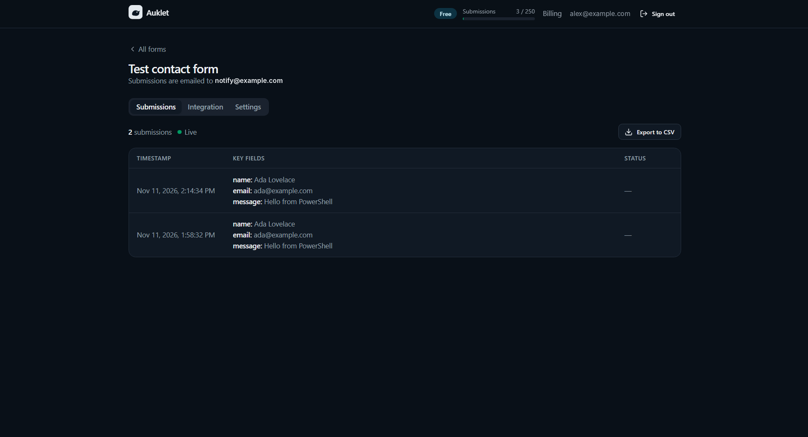
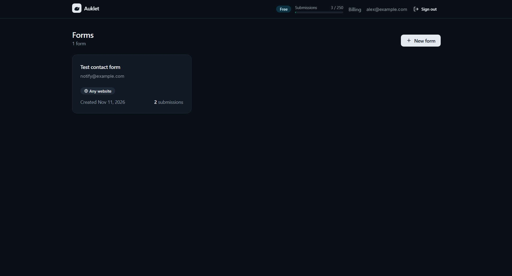
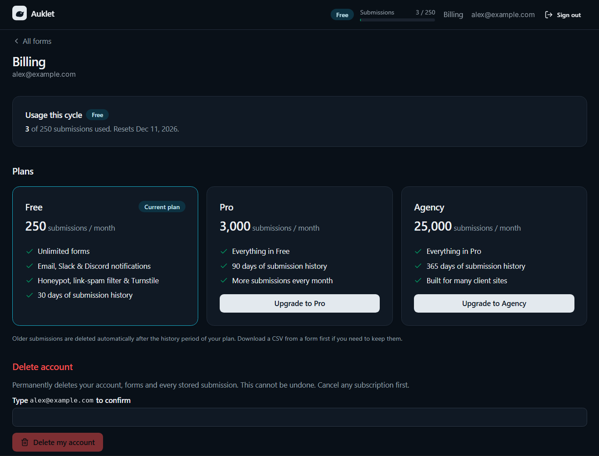
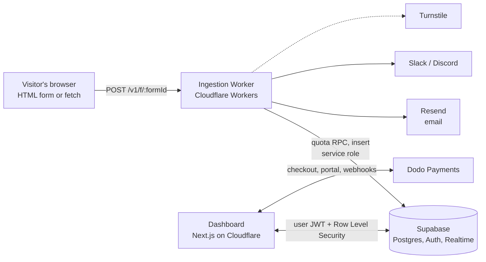

# Auklet Forms

[](https://github.com/rishipx/AukletForms/actions/workflows/ci.yml)
[](./LICENSE)


**Form endpoints for developers.** Point an HTML form or a `fetch()` call at Auklet and receive every submission by email, Slack and Discord, with a live dashboard, spam protection and subscription billing. No backend to write.

**Live demo:** <https://auklet-web.aukletform.workers.dev> (sign in with an emailed link; billing runs in Dodo's test mode, so no real payments are possible)

Built to run entirely on free tiers: Cloudflare Workers, Supabase, Resend and Dodo Payments.

<p align="center">
  
</p>
<p align="center">
  
  
</p>

## What it does

1. You create a form in the dashboard and get an endpoint: `POST /v1/f/:formId`.
2. Your site posts to it, from a plain HTML `<form>`, `fetch()` or `curl`. JSON, multipart and URL-encoded bodies are all accepted.
3. Auklet checks the request, stores the submission, and delivers it to your inbox, Slack and Discord.
4. You watch submissions arrive live in the dashboard, inspect each one and export CSV.

## Features

- **Delivery:** email through Resend, plus Slack and Discord webhooks. Sending happens after the visitor gets their response, so a slow provider never slows a form.
- **Spam and abuse protection:** honeypot field, link-stuffing detection, optional Cloudflare Turnstile per form, per-form allowed domains (CORS), an optional per-IP rate limit and a 64 KiB payload cap.
- **Live dashboard:** magic-link login (no passwords), real-time submission feed over Supabase Realtime, raw JSON, IP and user agent per submission, CSV export.
- **Plans and billing:** Free, Pro and Agency with monthly submission quotas, checkout and customer portal through Dodo Payments (merchant of record).
- **Operations:** daily email caps, plan-based data retention, a daily maintenance cron, and a weekly encrypted database backup workflow.
- **Self-host edition:** a single-file, database-free Worker under AGPL-3.0 with a one-click **Deploy to Cloudflare** button ([`apps/selfhost-worker`](./apps/selfhost-worker)).

## How it works



Request path in short: rate limit and size cap, then a cached form lookup, CORS and spam checks, an atomic quota decrement in SQL, the response to the visitor, and finally storage and delivery in the background. See [docs/architecture.md](./docs/architecture.md) for the full flow.

## Engineering highlights

- **Atomic quota in SQL.** `consume_submission_quota()` checks and increments in a single statement with cycle rollover, so concurrent submissions cannot overshoot a limit.
- **Row Level Security plus a column guard.** Users can edit their own profile, but a trigger blocks changes to plan, quota and billing columns, so nobody can upgrade themselves from the browser.
- **Idempotent, order-safe billing webhooks.** Each webhook id is claimed once, writes are absolute, and a per-profile watermark discards stale events, so a late `active` can never undo a `cancelled`.
- **Encrypted secrets at rest.** Turnstile secret keys are stored with AES-256-GCM; the dashboard encrypts, the Worker decrypts at use, and the browser never sees them.
- **Free-tier guard rails.** Atomic daily email caps, plan-based retention, a keep-alive cron for the free database, and a two-level form-config cache (memory, then KV).
- **Tested.** 197 unit and contract tests across the three apps, 51 pgTAP database assertions, and an 11-check end-to-end smoke test that runs against a real `wrangler dev` Worker. CI runs all of it on every push.
- **Errors as RFC 7807** problem details with stable `type` slugs.

The reasoning behind each decision is in [docs/architecture.md](./docs/architecture.md) and [docs/security.md](./docs/security.md).

## Tech stack

| Layer | Technology |
| --- | --- |
| Ingestion API | Cloudflare Workers, TypeScript, Workers KV, cron triggers |
| Dashboard | Next.js 16 (App Router), React 19, Tailwind CSS v4, deployed to Workers with OpenNext |
| Data and auth | Supabase: Postgres, Row Level Security, magic-link Auth, Realtime |
| Email | Resend |
| Billing | Dodo Payments (Standard Webhooks) |
| Bot protection | Cloudflare Turnstile |
| Tooling | Vitest, pgTAP, GitHub Actions, Dependabot, Prettier |

## Repository layout

| Path | What it is | Runs on |
| --- | --- | --- |
| [`apps/worker`](./apps/worker) | Public ingestion API `POST /v1/f/:formId` | Cloudflare Workers |
| [`apps/web`](./apps/web) | Dashboard: login, forms, live submissions, CSV export, billing | Next.js 16 on Cloudflare Workers (or Vercel) |
| [`apps/selfhost-worker`](./apps/selfhost-worker) | Open-source, single-file, database-free edition (AGPL-3.0) | Cloudflare Workers |
| [`supabase`](./supabase) | Migrations (tables, RLS, atomic quota, email budget, retention) and pgTAP tests | Supabase (Postgres) |
| [`scripts`](./scripts) | Mock Supabase API and an end-to-end smoke test | Node.js |
| [`docs`](./docs) | Setup guides, architecture, operations, security | |

## Get started

```bash
npm run install:all   # install every app's dependencies
npm test              # run all unit and contract tests
```

Then follow [docs/getting-started](./docs/getting-started/01-prerequisites.md) to create the accounts, apply the database migrations and deploy; allow about 90 minutes. The guides include Windows (PowerShell) commands. The [documentation index](./docs/README.md) lists everything else.

## Development

| Command | What it does |
| --- | --- |
| `npm run install:all` | `npm ci` in every app |
| `npm test` | Tests for the Worker, the dashboard and the self-host Worker |
| `npm run typecheck` | Type checks for all three apps |
| `npm run format` / `npm run format:check` | Format the code with Prettier / verify formatting |
| `npx supabase test db` | Database tests (needs Docker) |
| `node scripts/smoke.mjs` | End-to-end check of a running Worker ([how](./docs/getting-started/04-dashboard-local.md#optional-api-level-smoke-test)) |

CI ([`.github/workflows/ci.yml`](./.github/workflows/ci.yml)) runs all of these on every push. See [CONTRIBUTING.md](./CONTRIBUTING.md) and [SECURITY.md](./SECURITY.md).

## License

Auklet Forms is free software, licensed under the [GNU General Public License v3.0](./LICENSE) (`GPL-3.0-only`).

The self-host edition in [`apps/selfhost-worker`](./apps/selfhost-worker) is licensed separately under the [GNU Affero General Public License v3.0](./apps/selfhost-worker/LICENSE) (`AGPL-3.0-only`), so that modified copies offered over a network stay open. GPLv3 and AGPLv3 are compatible with each other (section 13 of each license), so the two parts can live in one repository.

Copyright (C) 2026 rishipx
